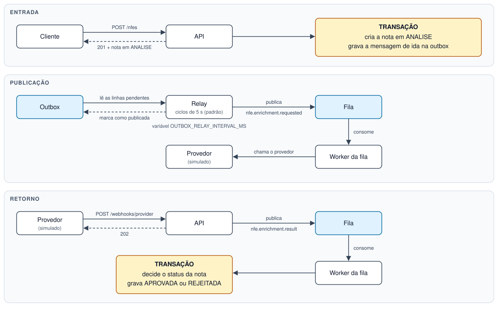

# Pipeline de entrada e enriquecimento de NF-e

O cliente envia a chave de acesso de uma nota fiscal, e o serviço grava a nota em `ANALISE`. Um provedor externo consulta a chave e devolve os dados da nota, e só então ela é aprovada ou rejeitada. O provedor é simulado.

**Tecnologias:** Node.js 22, NestJS 11, TypeScript, TypeORM, PostgreSQL 16, Docker, Jest e Supertest.

## Como subir

Requisito: Docker com Compose.

```bash
cp .env.example .env
docker compose up --build
```

A API responde em `http://localhost:3000`, e o PostgreSQL em `localhost:5432`. As migrations rodam ao subir.

## Como rodar os testes

Depois de criar o `.env`:

```bash
docker compose --profile test run --rm --build test
```

A saída lista cada teste, agrupado pelos itens que o enunciado pede. Para ver também a cobertura, com Node.js 22 local:

```bash
npm ci
docker compose --profile test up -d --wait db-test
npm run test:cov
```

Para remover o banco de teste sem afetar a aplicação:

```bash
docker compose --profile test rm -fsv db-test
```

## Fluxo da nota



Estados da nota: `ANALISE` -> `APROVADA` ou `REJEITADA`. Os dois últimos são finais.

## Contratos

### Ida: `nfe.enrichment.requested`

```json
{
  "nfeId": "ab179aef-d090-41ac-b97a-8d10e3eb77d3",
  "accessKey": "35261012345678000190550010000000011000000011"
}
```

### Volta: `nfe.enrichment.result`

Recebida em `POST /webhooks/provider`, com o header `x-webhook-token`.

```json
{
  "accessKey": "35261012345678000190550010000000011000000011",
  "cnpj": "12345678000190",
  "amount": "1234.56",
  "issueDate": "2026-10-30T12:00:00Z",
  "cancelled": false
}
```

| Campo | Formato | Se vier ausente ou inválido |
| --- | --- | --- |
| `accessKey` | String com 44 dígitos | Webhook responde `400` |
| `cnpj` | String com 14 dígitos, sem pontuação | Nota `REJEITADA` |
| `amount` | String decimal com até 2 casas | Nota `REJEITADA` |
| `issueDate` | ISO 8601, com ou sem horário | Nota `REJEITADA` |
| `cancelled` | Booleano; só `false` permite aprovar | Nota `REJEITADA` |

## O que ficou de fora

| Item | Motivo |
| --- | --- |
| Reprocessamento de mensagens `DEAD` | Se a chamada ao provedor esgotar as tentativas, a nota fica em `ANALISE` até uma ação manual |
| Backoff exponencial | O teste usa uma espera fixa entre as tentativas |

## Implementação da IA x Alterações

| Implementação da IA | Alteração / Correção |
| --- | --- |
| O provedor publicava o resultado direto na fila | O retorno passou a ser um webhook que publica na fila |
| A chave de acesso era validada manualmente no controller | A validação passou a usar DTOs com `class-validator` e `class-transformer` |
| Os recursos do TypeORM eram pouco aproveitados, nas datas da entidade e na gestão de migrations | Passaram a ser usados os decorators próprios de data e a CLI, com scripts para gerenciar as migrations |
| Havia poucos logs, com pouca informação sobre cada etapa | Foram adicionados logs por evento em todo o fluxo, para rastrear cada nota pela chave de acesso |
| Uma chave já recebida era ignorada, e a API seguia respondendo com a nota existente | A criação passou a responder `409 Conflict`, com o id da nota existente |
| O resultado do provedor tentava atualizar a nota antes de verificar se ela existia | A nota passou a ser buscada e travada antes da atualização; chave inexistente ou nota já decidida encerram sem alterar nada |
